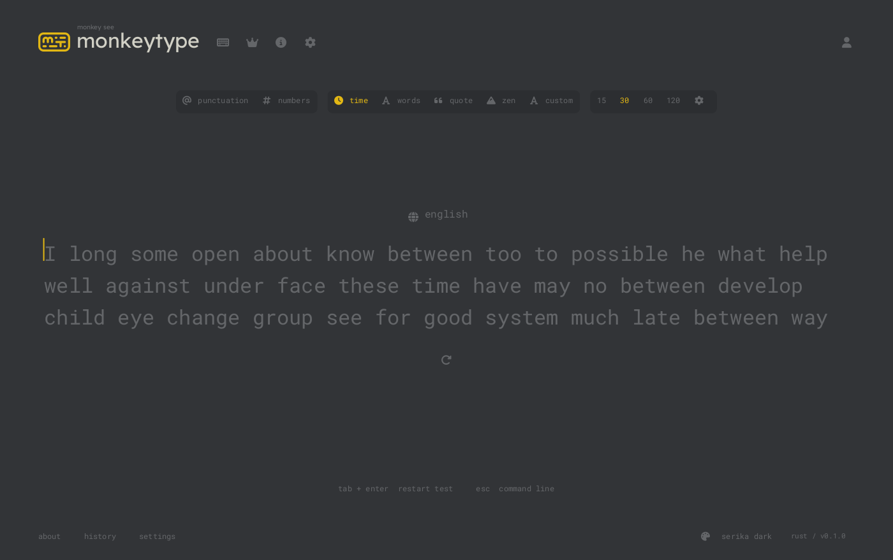
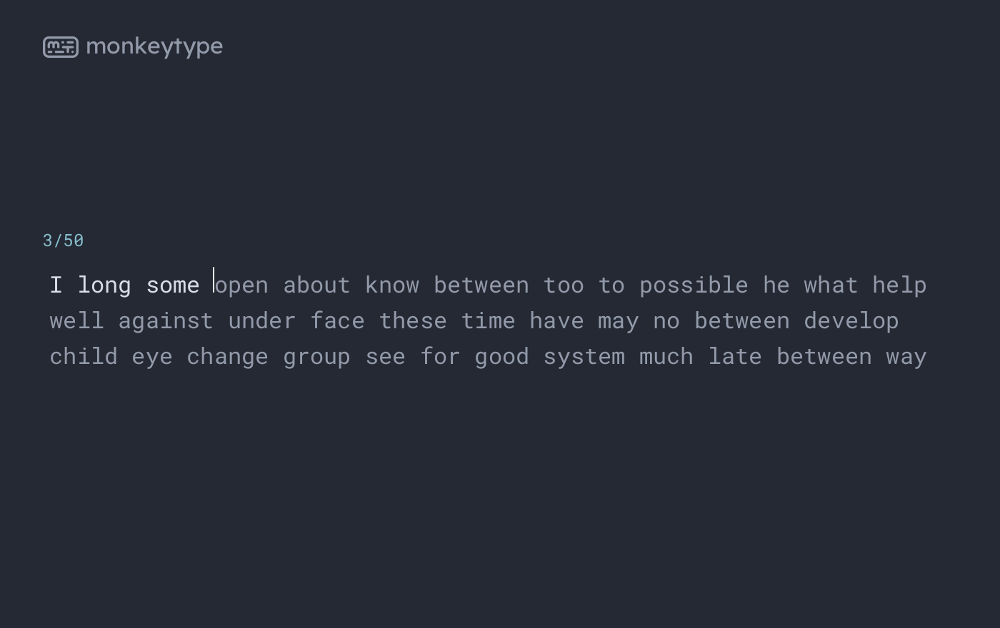
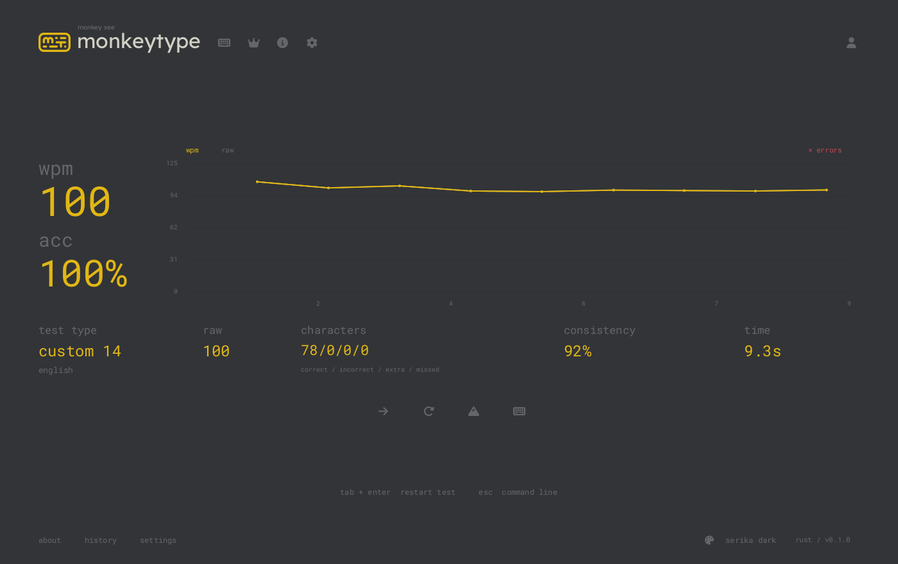

# Terminaltype

Monkeytype in a Kitty terminal, written in Rust. Practice with timed tests, word counts, quotes, or your own text. The app draws the interface through Kitty graphics, using Monkeytype's fonts and theme colors.



## Run it

You need [Kitty](https://sw.kovidgoyal.net/kitty/) and Rust 1.88 or newer. Linux is the tested platform. Run the app directly in Kitty; tmux is not supported.

```sh
git clone https://github.com/frankischilling/terminaltype.git
cd terminaltype
./run
```

The first run builds a release binary. Later runs reuse the build unless the source has changed. The executable is named `monkeytype-tui`:

```sh
cargo build --release --locked
./target/release/monkeytype-tui

# Install the command on your PATH
cargo install --path . --locked
monkeytype-tui
```

Fonts and word lists are embedded in the binary. The installed app does not need a browser, Python, or a network connection.

## Pick a test

```sh
./run --time 60
./run --words 50 --theme nord
./run --mode quote
./run --mode zen
./run --custom 'The quick brown fox jumps over the lazy dog.'
```

Tests start with the first character you type. Use the mouse to change modes, or press `Esc` to search commands. There are 187 theme palettes, 11 dictionaries, and 6,488 English quotes. Punctuation, numbers, blind mode, and stricter difficulty settings are available in the app.



| Key | Action |
| --- | --- |
| `Esc` | Open commands, go back, or close a dialog |
| `↑` / `↓`, then `Enter` | Choose a command |
| `Tab`, then `Enter` | Restart the test |
| `Ctrl+R` | Restart immediately |
| `Backspace` | Correct a character |
| `Ctrl+W` / `Ctrl+Backspace` | Delete the current word |
| `Enter` in zen mode | Finish the test |
| `Ctrl+C` / `Ctrl+D` | Quit |

## Results stay on your machine

The results screen shows WPM, raw speed, accuracy, character counts, consistency, and a speed chart. You can review the words you typed and browse up to 1,000 saved results.



Settings and results live in `~/.local/share/monkeytype-tui`, or under `$XDG_DATA_HOME` if it is set. Use `--data-dir PATH` for a separate profile.

These screenshots come from running Kitty sessions. The capture script types the examples; the scores are not a person's typing record or a performance benchmark.

## Rendering and responsiveness

Input has its own reader, and key presses trigger a paint without waiting for the animation frame limit. Cached fonts and word layers cut repeated drawing work. The screen uses small Kitty image tiles, so a caret movement replaces the affected tiles instead of a full-screen texture.

The caret animates at up to 120 Hz by default. Set `--fps 144` for a different limit, or `--scale 1.5` for larger controls and text. This is an animation limit, not a measured display rate. [Rendering notes](docs/rendering.md) explain the transport and the limits of the latency tests.

## Docs and development

- [Usage and settings](docs/usage.md)
- [Rendering and performance tests](docs/rendering.md)
- [Building, testing, and screenshots](docs/development.md)
- [Contributing](CONTRIBUTING.md)

```sh
cargo test --locked
cargo clippy --all-targets -- -D warnings
```

This app covers local typing practice. It does not include Monkeytype accounts, online leaderboards, multiplayer, funboxes, every website setting, or theme-specific CSS effects. Other graphics terminals and operating systems have not been validated. Browser and terminal performance parity has not been established.

The code is licensed under [GPL-3.0-or-later](LICENSE). Fonts retain their own licenses. See [NOTICE](NOTICE) for Monkeytype and font credits. Terminaltype is not affiliated with Monkeytype.
